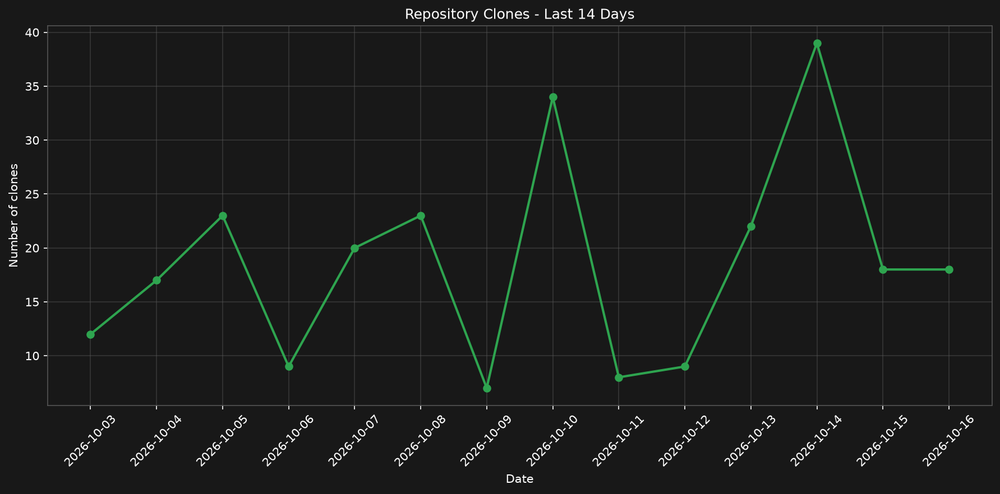
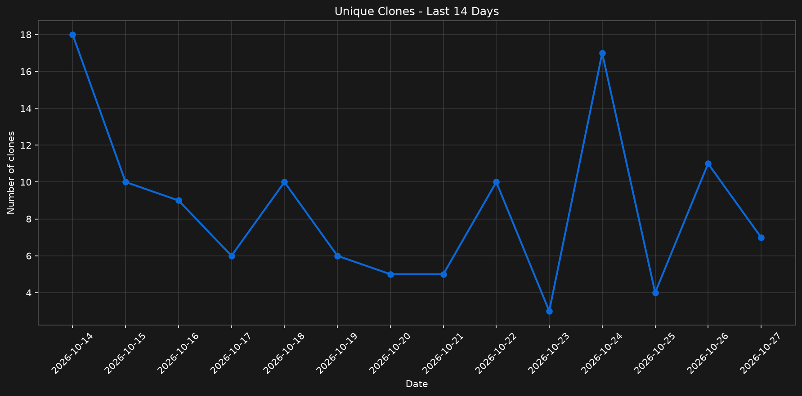

# 🛠️ AllTool-Linux

> A modular command-line toolkit for Linux bundling 20+ everyday utilities behind a single `alltool` command — files, media, networking, power, scripting, security, and more. Ships with an interactive installer (Debian, Arch, Fedora, openSUSE).

# Install

```sh
curl -fsSL https://raw.githubusercontent.com/Hajjani/AllTool-Linux/refs/heads/Stable/installer.sh | bash
```


# Growth of the project




[Get the full data](https://github.com/Hajjani/AllTool-Linux/pulse)

# Commands

| Command | Does what |
|---|---|
| `create` | Create a file (and parent folders) |
| `format` (`fmt`) | Format a disk (ntfs, ext4, vfat) |
| `refresh` | Refresh setup, permissions, PATH |
| `help` | Show help (en, fr, ar, de) |
| `sound` | Play audio + control playback (see below) |
| `video` | Play video |
| `netspeed` | Measure network speed |
| `sif` (`sysinfo`) | Detailed system info |
| `sf` (`ls`) | List files |
| `up` (`update-check`) | Check for system updates |
| `power` (`pwr`) | Power profiles + shutdown/reboot/sleep/lock |
| `run` (`exec`) | Auto-detect and run scripts (py, sh, js, rb, php, java, c/c++, …) |
| `psg` (`passgen`) / `hs` (`hash`) | Generate passwords / hash files |
| `sr` (`search`) / `wea` (`weather`) | Web search / weather |
| `pr` (`pomodoro`) | Pomodoro timer |
| `upa` (`update`) / `un` (`uninstall`) | Update / uninstall AllTool |
| `requirement` (`req`) / `cl` (`clear`) | Check dependencies / clear terminal |
| `version` (`-v`, `--version`) | Show version (from `.confs.json`) |

## Notes

- Missing external tools (`mpv`, `ffmpeg`, `inxi`, …) print the install
  command for your distro (Debian/Arch/Fedora/openSUSE) and offer to
  install them on the spot.
- The installer lets you pick optional packages by number
  (`> 1,2,5`, ranges like `1-3`, `all`, or `none`).
