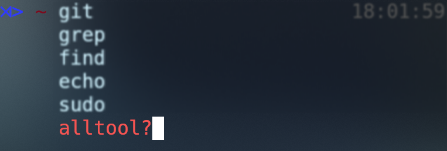
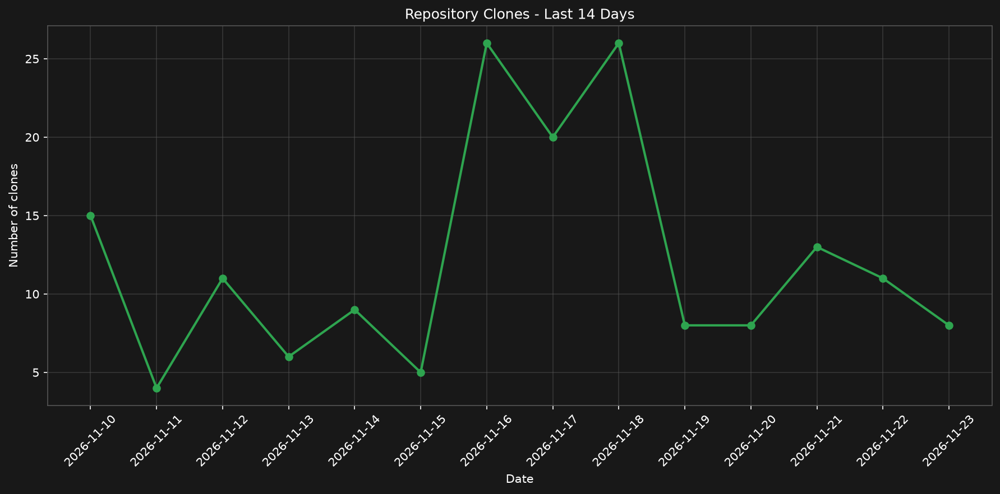
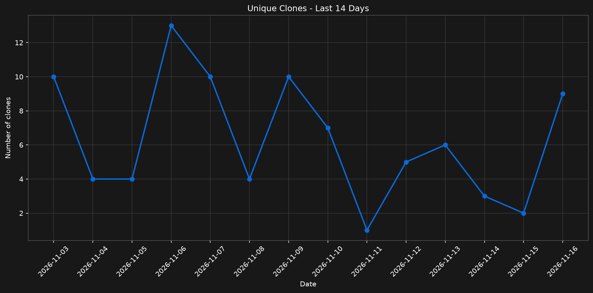

# 🛠️ AllTool-Linux



> A modular command-line toolkit for Linux bundling 20+ everyday utilities behind a single `alltool` command — files, media, networking, power, scripting, security, productivity, and system management. Ships with an interactive installer (Debian, Arch, Fedora, openSUSE).

## Install

```sh
curl -fsSL https://raw.githubusercontent.com/Hajjani/AllTool-Linux/refs/heads/Stable/installer.sh | bash
```

## Growth of the project



## What it offers

| Area | What you get |
|------|--------------|
| **Files** | `create`, `format` (ntfs/ext4/vfat), `sf`/`ls`, `refresh` (permissions + PATH) |
| **Media** | `sound` (mpv playback, stop/play/repeat/volume), `video` (ffplay) |
| **Networking** | `netspeed`, `sr`/`search` (web), `wea`/`weather` |
| **System** | `sif`/`sysinfo` (inxi), `up`/`update-check` (apt/pacman/dnf/zypper), `cl`/`clear`, `requirement`/`req` |
| **Power** | `power`/`pwr` — profiles (`pws`/`pwn`/`pwp`), status (`pwst`), shutdown/reboot/logout/suspend/hibernate/lock |
| **Scripts** | `run`/`exec` — auto-detect & run py/sh/js/rb/rb/pl/php/java/c/c++ (C/C++ compiled with cache) |
| **Security** | `psg`/`passgen` (passwords), `hs`/`hash` (md5/sha/blake2) |
| **Productivity** | `pr`/`pomodoro` timer |
| **Lifecycle** | `upa`/`update`, `un`/`uninstall`, `version` (`-v`/`--version`) |
| **Help** | `help` — en, fr, ar, de |

Full command list:

| Command | Alias | Does what |
|---|---|---|
| `create` | — | Create a file (auto-creates parent folders) |
| `format` | `fmt` | Format a disk (ntfs, ext4, vfat) |
| `refresh` | — | Refresh setup, permissions, PATH |
| `help` | — | Show help (en, fr, ar, de) |
| `sound` | — | Play audio + playback control (st/pl/rp/N%) |
| `video` | — | Play video (ffplay) |
| `netspeed` | — | Measure network speed |
| `sif` | `sysinfo` | Detailed system info |
| `sf` | `ls` | List files |
| `up` | `update-check` | Check for system updates |
| `power` | `pwr` | Power profiles + shutdown/reboot/sleep/lock |
| `run` | `exec` | Auto-detect and run scripts (py, sh, js, rb, pl, php, java, c/c++, …) |
| `psg` | `passgen` | Generate secure passwords |
| `hs` | `hash` | Calculate file hashes |
| `sr` | `search` | Web search |
| `wea` | `weather` | Weather for a city |
| `pr` | `pomodoro` | Pomodoro timer |
| `upa` | `update` | Update AllTool |
| `un` | `uninstall` | Uninstall AllTool |
| `requirement` | `req` | Check dependencies |
| `cl` | `clear` | Clear terminal |
| `version` | `-v`, `--version` | Show version (from `.confs.json`) |

## Extensions

AllTool ships an extension system in `AllTool-Linux/extentions/` (and per-user `~/.config/alltool/extentions/`). Any `.py` file placed there that exposes callable functions is auto-discovered, validated, and registered as an `alltool` command.

Every extension **must** declare a module-level `ALLTOOL_VER` (`str`) — the required alltool version (exact `"3.2.0"` or specifier `">=3.2.0"` / `"~=3.2"`). It is checked against the single source of truth — the `"version"` key of `.confs.json`. Extensions that fail validation are skipped with a warning; they never silently register commands.

## Developer API (single import)

All developer-facing helpers are re-exported from the `Tools` package, so you never retype a submodule path:

```python
from Tools import RootEx, get_version, list_commands, confirm, write_file, ensure_dir, ...
```

See The wiki for the full API reference including `RootEx(action, description)` — run an extension function as root, prompting the user **every time** (privileges are never cached; sudo environment is sanitized).

## Notes

- Missing external tools (`mpv`, `ffmpeg`, `inxi`, `speedtest-cli`, `powerprofilesctl`, …) print the install command for your distro (Debian/Arch/Fedora/openSUSE) and offer to install them on the spot.
- Cached sudo credentials live in `.confs.json` (scheme `v2`): ChaCha20-encrypted under a PBKDF2-HMAC-SHA256 key bound to your username, with an HMAC-SHA256 tag. Renaming your user invalidates the old record automatically (self-heal).
- The installer lets you pick optional packages by number (`> 1,2,5`, ranges `1-3`, `all`, or `none`).

## Entry points

Once installed, call alltool on your system using:

```
alltool [command] [flags if supported]
```

Examples:
- `alltool version`
- `alltool create <filename>`
- `alltool format <disk> <type>`
- `alltool sound st`
- `alltool power pwst`
- `alltool run <script> [-t] [-- args...]`

All entry points (`./alltool`, `python3 -m Tools`, `python3 AllTools.py`, installed `alltool` console script) delegate to the same `Tools.main()`, but the recommended way to invoke alltool on a user system is `alltool [command] [flags if supported]`.
